# AIStudio Image Types

AIStudio can produce **20 types of image**. Each type is defined once, in the `styles.types` section of `config.yaml`, and that one definition drives everything: the catalogue the orchestrator LLM chooses from, how it writes the prompt, the shape and model used, the FLUX guidance, the negative prompt and the safety checks applied afterwards.

This document is generated from `config.yaml`, and every example image is a real AIStudio run from your Output folder, shown with the request and the prompt that produced it. Regenerate it after changing a type or making better examples (see *Keeping this document current* at the end).

## Choosing a type

You normally don't need to. The orchestrator reads your request and picks the type whose trigger words match best; the most specific match wins, and a medium you name always beats the subject ("a portrait in watercolour" is `watercolour`, not `portrait`). If nothing matches, it uses `photo`.

To force a type, or see the list:

```zsh
python controller.py "a heron at Langstone Harbour" --style watercolour
python controller.py --list-styles
```

`--style` tells the LLM which type to write for, so the prompt is written in that type's language, not just relabelled. `--workflow` and `--model` still override shape and model afterwards, except that a type with a fixed workflow keeps it.

## Words in the image

Any type can carry words: a poster title, a logo's name, a sign. Ask for them and put the exact words in quotes:

```zsh
python controller.py 'a railway poster for Southsea seafront titled "SOUTHSEA"'
python controller.py 'a logo for my studio reading "Angus Photo"'
```

The orchestrator copies the words into a `text` field and writes them into the prompt in quotes, with their style and position. AIStudio then makes sure they can be read:

- the run switches to `highest_quality`, because FLUX Schnell can't spell;
- guidance is raised to at least 4.0, so FLUX sticks to the wording;
- "text", "lettering" and similar are removed from the negative prompt;
- anything over 40 characters is allowed but warned about: short wording, a word or two, renders most reliably.

Without quoted words FLUX may still invent some lettering, and invented lettering is usually gibberish. Settings are in `styles.text` in `config.yaml`; the words used are recorded in each run's `Metadata.json`.

## The three families

Every type belongs to a family, which sets the vocabulary the LLM is allowed to use:

| Family | Types | Rule |
|---|---|---|
| Photographic | `photo`, `portrait`, `landscape`, `macro`, `product`, `architecture`, `monochrome`, `cinematic` | Photographic language welcome: light, lens, depth of field. |
| Graphic | `clipart`, `logo`, `icon`, `pixel_art`, `vintage_poster` | No photographic language at all; named colours are honoured; fixed backgrounds where set. |
| Art and illustration | `illustration`, `watercolour`, `oil_painting`, `pencil_sketch`, `line_art`, `storybook`, `3d_render` | Describe medium and technique; no photographic language. |

## Quick reference

| Type | Produces | Shape | Model | Guidance |
|---|---|---|---|---|
| [`photo`](#photo) | General realistic photograph | landscape, 1536x1024 | photorealistic | 3.5 |
| [`portrait`](#portrait) | Photographic portrait of a person or animal | portrait, 1024x1536 | photorealistic | 3.0 |
| [`landscape`](#landscape) | Wide scenic photograph of land, sea or sky | landscape, 1536x1024 | photorealistic | 3.5 |
| [`macro`](#macro) | Extreme close-up photograph of small subjects | macro, 1344x1024 | photorealistic | 3.5 |
| [`product`](#product) | Clean studio product shot | square, 1152x1152 | photorealistic | 4.0 |
| [`architecture`](#architecture) | Buildings, interiors and urban scenes | landscape, 1536x1024 | photorealistic | 4.0 |
| [`monochrome`](#monochrome) | Black-and-white photograph | landscape, 1536x1024 | photorealistic | 3.5 |
| [`cinematic`](#cinematic) | Film still with movie-style colour and framing | landscape, 1536x1024 | photorealistic | 3.0 |
| [`clipart`](#clipart) | Simple flat clip art | clipart (fixed), 1024x1024 | fast_preview | 3.0 |
| [`logo`](#logo) | Logo mark or emblem | clipart (fixed), 1024x1024 | fast_preview | 3.5 |
| [`icon`](#icon) | Single-glyph button or app icon, legible at small sizes | clipart (fixed), 1024x1024 | fast_preview | 3.5 |
| [`pixel_art`](#pixel_art) | Retro 8-bit or 16-bit pixel art | square (fixed), 1152x1152 | highest_quality | 4.0 |
| [`vintage_poster`](#vintage_poster) | Retro travel or advertising poster | portrait, 1024x1536 | highest_quality | 3.5 |
| [`illustration`](#illustration) | General digital illustration | landscape, 1536x1024 | highest_quality | 3.5 |
| [`watercolour`](#watercolour) | Loose, translucent watercolour painting | landscape, 1536x1024 | highest_quality | 3.0 |
| [`oil_painting`](#oil_painting) | Traditional oil painting on canvas | landscape, 1536x1024 | highest_quality | 3.0 |
| [`pencil_sketch`](#pencil_sketch) | Graphite or charcoal drawing | portrait, 1024x1536 | highest_quality | 3.5 |
| [`line_art`](#line_art) | Clean black ink outlines, colouring-book style | square (fixed), 1152x1152 | highest_quality | 4.0 |
| [`storybook`](#storybook) | Warm children's picture-book illustration | landscape, 1536x1024 | highest_quality | 3.5 |
| [`3d_render`](#3d_render) | Polished 3D render or isometric scene | square, 1152x1152 | highest_quality | 3.5 |

Shape is the default workflow and its canvas size; the LLM may adjust the size to suit the content. Models `photorealistic` and `highest_quality` are FLUX Dev; `fast_preview` is FLUX Schnell (capped at 4 steps).

## Photographic types

### `photo`

**General realistic photograph.** Chosen when: the user asks for a photo, picture or realistic image and no more specific photographic type fits.

| Setting | Value |
|---|---|
| Workflow | `landscape` (1536x1024) |
| Model | `photorealistic` |
| FLUX guidance | 3.5 |
| Always avoided | illustration, painting, cartoon, CGI, oversaturated |

**Prompt pattern** (X is your subject):

> photograph of X, natural light, true-to-life colour, sharp focus on the subject, believable setting

**Example**

```zsh
python controller.py "a red kite flying over Southsea Castle at sunrise"
```

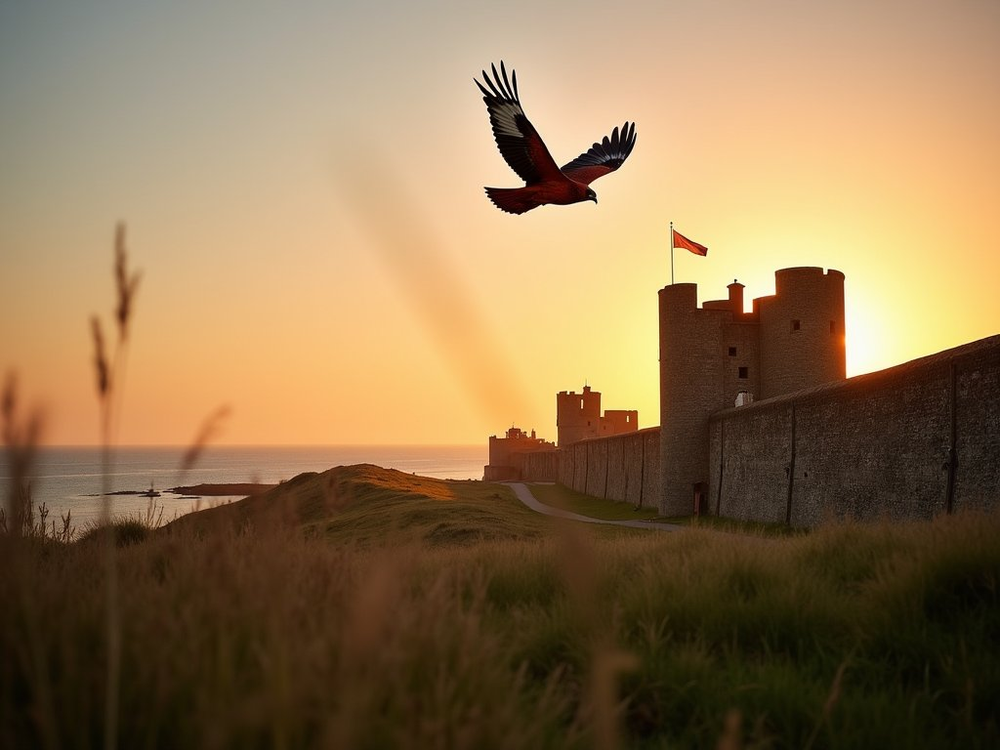

<sub>`photorealistic` · 30 steps · seed 530257450 · 26 s · orchestrator chose `landscape` · Output/2026/10/2026-10-27 Red Kite Over Southsea Castle</sub>

Prompt the orchestrator wrote:

> landscape photograph of a vibrant red kite soaring above the historic stone walls of Southsea Castle at sunrise, wide-angle, golden-hour light, strong foreground interest, deep focus, atmospheric depth

### `portrait`

**Photographic portrait of a person or animal.** Chosen when: portrait, headshot, close-up of a face, a person posing, pet portrait.

| Setting | Value |
|---|---|
| Workflow | `portrait` (1024x1536) |
| Model | `photorealistic` |
| FLUX guidance | 3.0 |
| Always avoided | plastic skin, airbrushed, distorted hands, extra fingers, cartoon |

**Prompt pattern** (X is your subject):

> portrait photograph of X, 85mm lens, shallow depth of field, soft directional window light, natural skin texture, eyes in sharp focus

**Example**

```zsh
python controller.py "an elderly fisherman mending nets on Hayling Island"
```

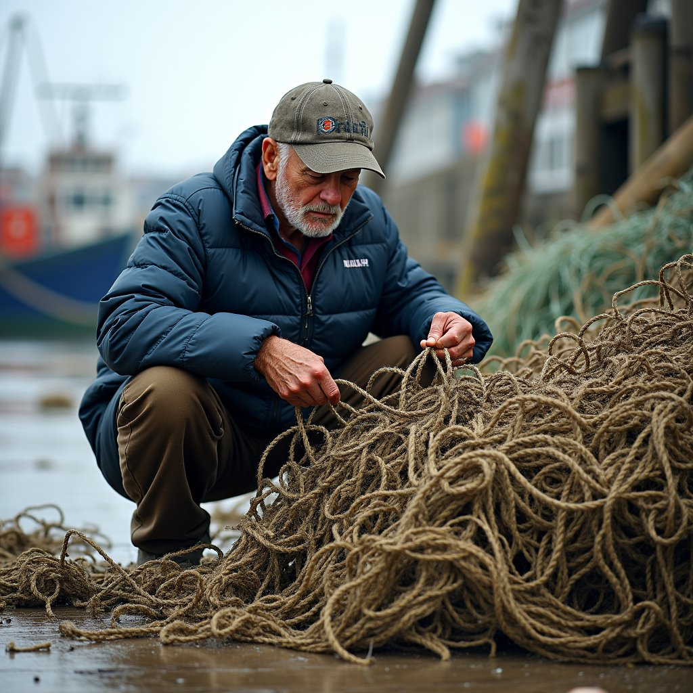

<sub>`photorealistic` · 30 steps · seed 3783687899 · 36 s · orchestrator chose `photo` · Output/2026/10/2026-10-27 Fisherman Mending Nets</sub>

Prompt the orchestrator wrote:

> photograph of an elderly fisherman with weathered skin and a worn cap mending large, tangled fishing nets on a rustic wooden pier at Hayling Island, natural light, true-to-life colour, sharp focus on the subject, believable setting

### `landscape`

**Wide scenic photograph of land, sea or sky.** Chosen when: landscape, seascape, scenery, view, coastline, mountains, sunset over somewhere.

| Setting | Value |
|---|---|
| Workflow | `landscape` (1536x1024) |
| Model | `photorealistic` |
| FLUX guidance | 3.5 |
| Always avoided | people in foreground, text, oversaturated, HDR halos |

**Prompt pattern** (X is your subject):

> landscape photograph of X, wide-angle, golden-hour light, strong foreground interest, deep focus, atmospheric depth

**Example**

```zsh
python controller.py "the Isle of Wight from Southsea beach at dusk"
```

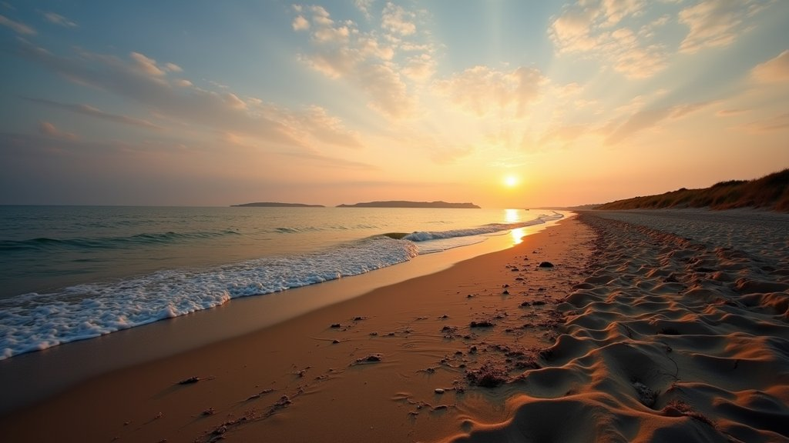

<sub>`photorealistic` · 30 steps · seed 2939233130 · 32 s · Output/2026/10/2026-10-27 Isle of Wight Dusk View</sub>

Prompt the orchestrator wrote:

> landscape photograph of the Isle of Wight visible across the Solent from the shoreline of Southsea beach at dusk, wide-angle, golden-hour light, strong foreground interest, deep focus, atmospheric depth

### `macro`

**Extreme close-up photograph of small subjects.** Chosen when: macro, close-up of an insect, flower, droplet, texture or small object.

| Setting | Value |
|---|---|
| Workflow | `macro` (1344x1024) |
| Model | `photorealistic` |
| FLUX guidance | 3.5 |
| Always avoided | wide view, cluttered background, cartoon |

**Prompt pattern** (X is your subject):

> macro photograph of X, 1:1 magnification, razor-thin depth of field, fine detail, soft diffused light, clean blurred background

**Example**

```zsh
python controller.py "a dewdrop on a spider's web"
```

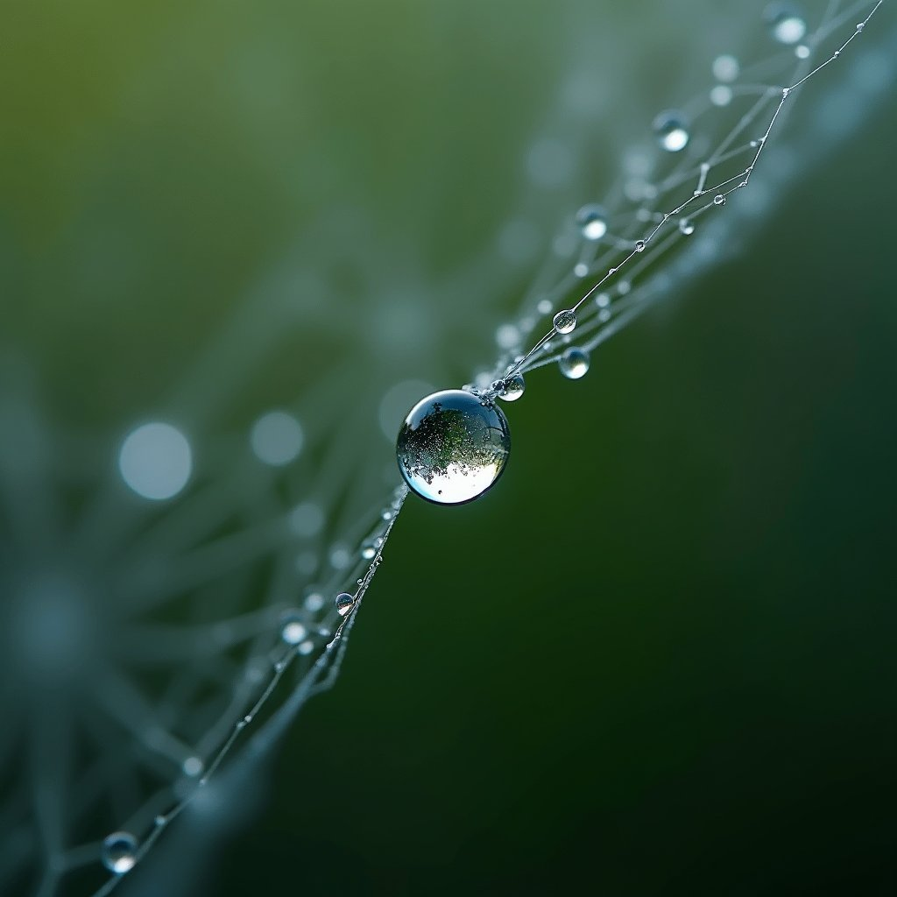

<sub>`photorealistic` · 30 steps · seed 2677362612 · 36 s · Output/2026/10/2026-10-27 Dewdrop on Spider Web</sub>

Prompt the orchestrator wrote:

> macro photograph of a single, crystal-clear dewdrop clinging to a delicate, intricate spider's web, 1:1 magnification, razor-thin depth of field, fine detail, soft diffused light, clean blurred background

### `product`

**Clean studio product shot.** Chosen when: product shot, packshot, e-commerce, catalogue, an object for sale.

| Setting | Value |
|---|---|
| Workflow | `square` (1152x1152) |
| Model | `photorealistic` |
| FLUX guidance | 4.0 |
| Always avoided | clutter, people, hands, harsh shadows, text, watermark |

**Prompt pattern** (X is your subject):

> studio product photograph of X, centred, seamless light-grey backdrop, softbox lighting, subtle reflection, crisp edges, commercial look

**Example**

```zsh
python controller.py "a leather camera strap"
```

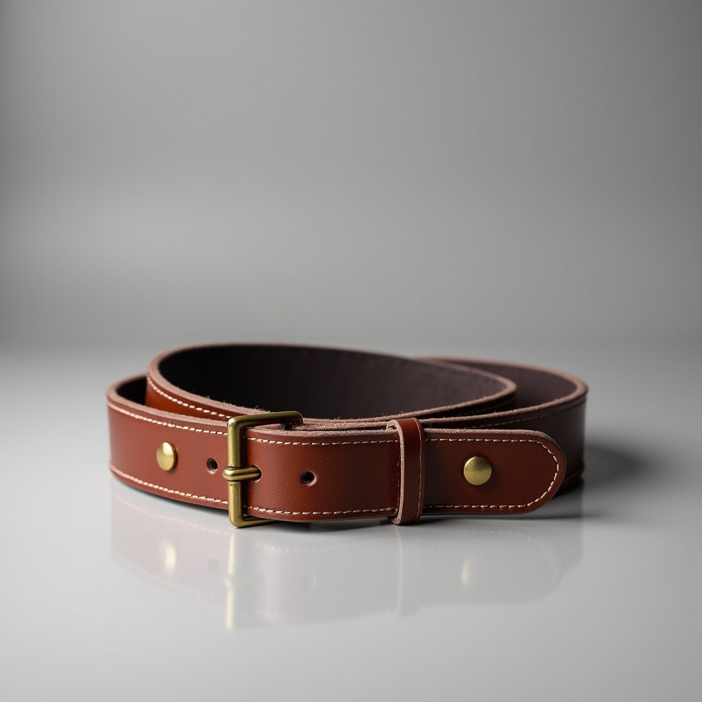

<sub>`photorealistic` · 30 steps · seed 4155261712 · 36 s · Output/2026/10/2026-10-27 Leather Camera Strap Product Shot</sub>

Prompt the orchestrator wrote:

> studio product photograph of a premium handcrafted brown leather camera strap with brass hardware, centred, seamless light-grey backdrop, softbox lighting, subtle reflection, crisp edges, commercial look

### `architecture`

**Buildings, interiors and urban scenes.** Chosen when: building, architecture, interior, room, street, cityscape, bridge.

| Setting | Value |
|---|---|
| Workflow | `landscape` (1536x1024) |
| Model | `photorealistic` |
| FLUX guidance | 4.0 |
| Always avoided | converging verticals, fisheye distortion, crowds |

**Prompt pattern** (X is your subject):

> architectural photograph of X, straight verticals, balanced composition, even light, clean lines, rich material detail

**Example**

```zsh
python controller.py "the Spinnaker Tower from Gunwharf Quays at blue hour"
```

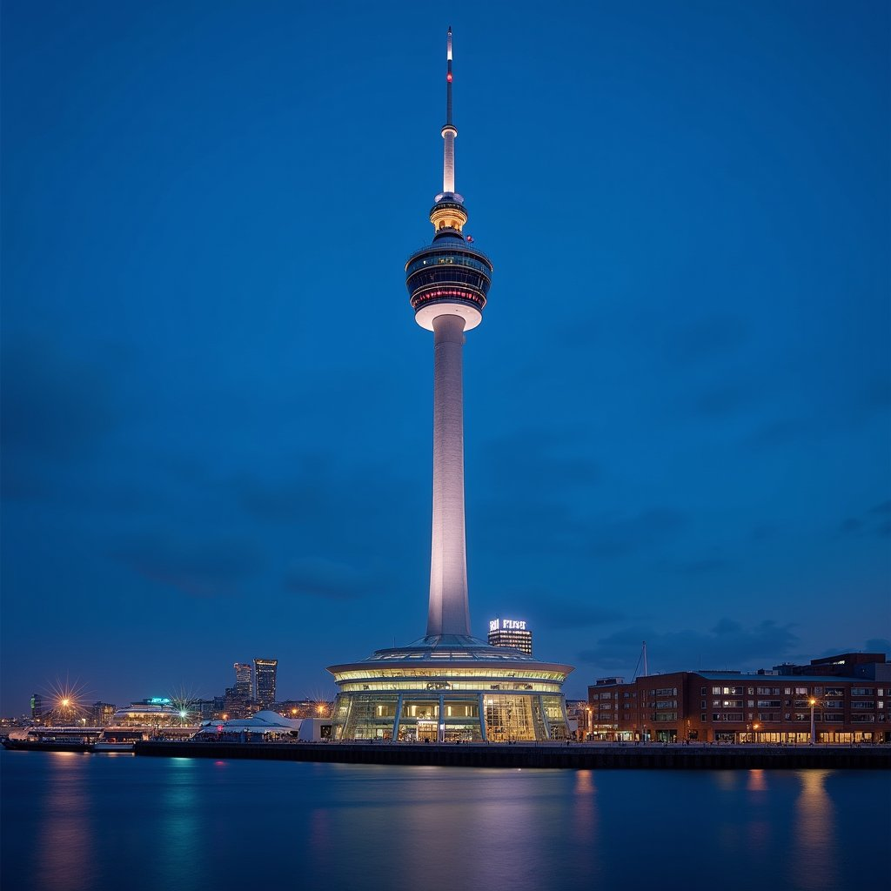

<sub>`photorealistic` · 30 steps · seed 4283020715 · 36 s · Output/2026/10/2026-10-27 Spinnaker Tower Blue Hour (2)</sub>

Prompt the orchestrator wrote:

> architectural photograph of the Spinnaker Tower in Portsmouth, viewed from Gunwharf Quays during the blue hour, with city lights beginning to twinkle and a deep indigo sky, straight verticals, balanced composition, even light, clean lines, rich material detail

### `monochrome`

**Black-and-white photograph.** Chosen when: black and white, monochrome, B&W, mono, film noir.

| Setting | Value |
|---|---|
| Workflow | `landscape` (1536x1024) |
| Model | `photorealistic` |
| FLUX guidance | 3.5 |
| Always avoided | colour, sepia tint, washed-out greys |

**Prompt pattern** (X is your subject):

> black and white photograph of X, rich tonal range, deep blacks, fine film grain, strong contrast and shape

**Example**

```zsh
python controller.py "a rainy Portsmouth street at night"
```

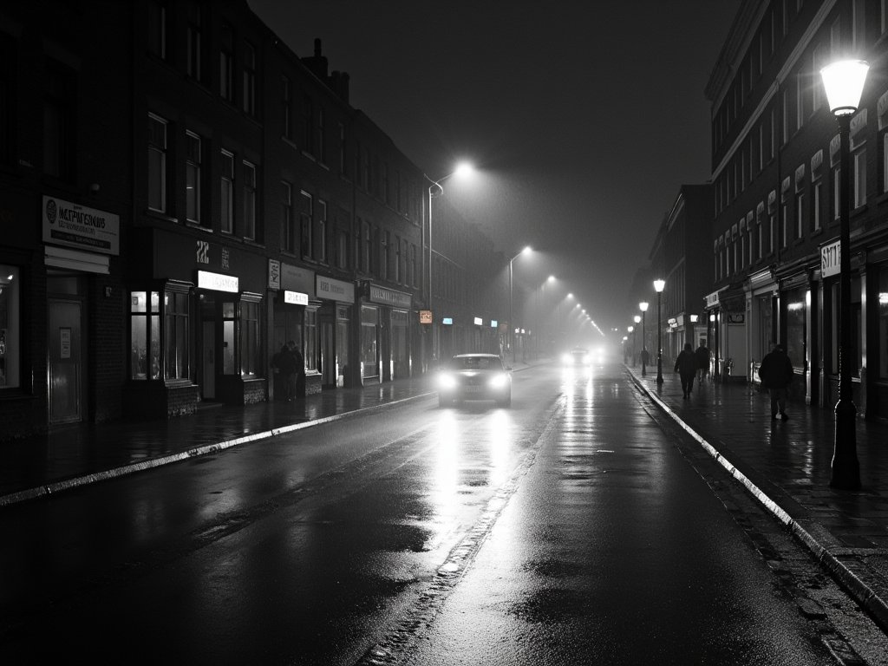

<sub>`photorealistic` · 30 steps · seed 204735612 · 28 s · Output/2026/10/2026-10-27 Rainy Portsmouth Street Night</sub>

Prompt the orchestrator wrote:

> black and white photograph of a rainy Portsmouth street at night, wet pavement reflecting streetlights, rich tonal range, deep blacks, fine film grain, strong contrast and shape

### `cinematic`

**Film still with movie-style colour and framing.** Chosen when: cinematic, film still, movie scene, dramatic, widescreen.

| Setting | Value |
|---|---|
| Workflow | `landscape` (1536x1024) |
| Model | `photorealistic` |
| FLUX guidance | 3.0 |
| Always avoided | flat lighting, snapshot, cartoon, text |

**Prompt pattern** (X is your subject):

> cinematic film still of X, anamorphic widescreen framing, moody colour grade, motivated lighting, shallow depth of field

**Example**

```zsh
python controller.py "cinematic shot of Spiderman in Guildhall Square"
```

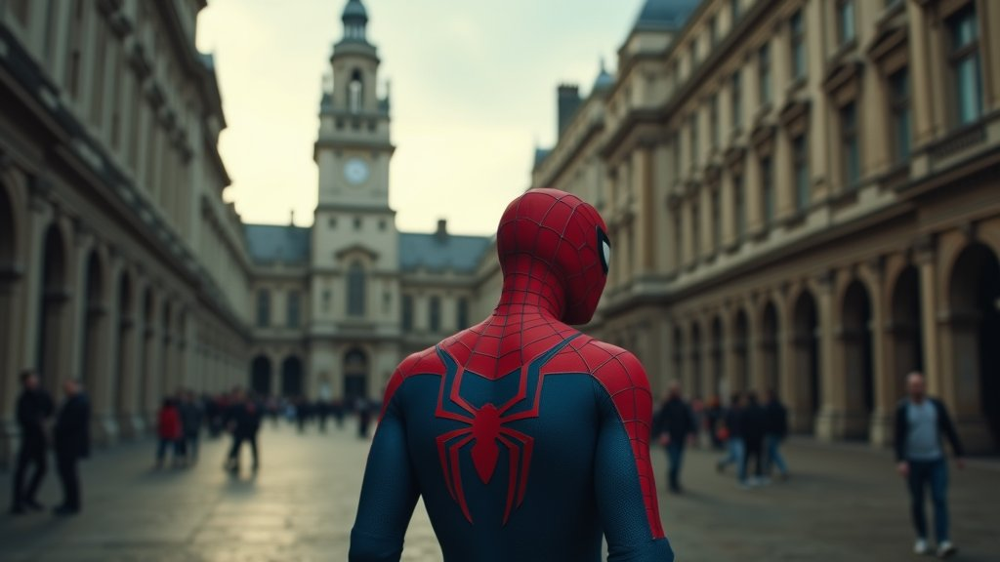

<sub>`photorealistic` · 30 steps · seed 946715482 · 20 s · Output/2026/10/2026-10-28 Spiderman in Guildhall Square</sub>

Prompt the orchestrator wrote:

> cinematic film still of Spiderman amidst the historic architecture of Guildhall Square, anamorphic widescreen framing, moody colour grade, motivated lighting, shallow depth of field

## Graphic types

### `clipart`

**Simple flat clip art.** Chosen when: clip art, clipart, cartoon, sticker, simple graphic, or a request naming a small colour palette.

| Setting | Value |
|---|---|
| Workflow | `clipart` (1024x1024), fixed |
| Model | `fast_preview` |
| FLUX guidance | 3.0 |
| Background | mid-blue, unless you name one |
| Always avoided | photograph, realistic, texture, shading, gradients, text |

**Prompt pattern** (X is your subject):

> simple flat clip art illustration of X, bold solid colours, clean thick outlines, minimal detail, no shading, no gradients, vector graphic style

**Example**

```zsh
python controller.py "yellow frog clip art"
```

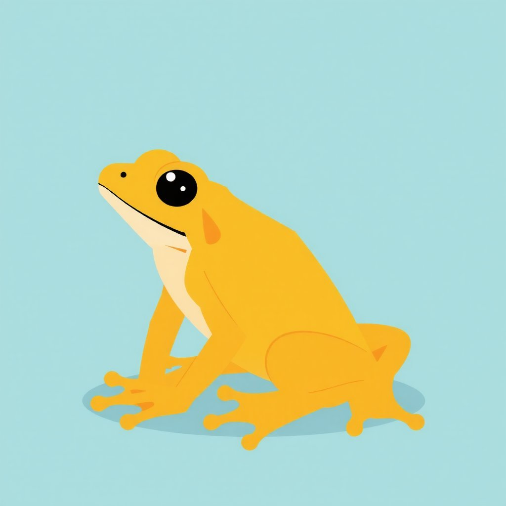

<sub>`fast_preview` · 30 steps · seed 2941264527 · 62 s · Output/2026/10/2026-10-27 Yellow Frog Clip Art</sub>

Prompt the orchestrator wrote:

> simple flat clip art illustration of a yellow frog, bold solid colours, clean thick outlines, minimal detail, no shading, no gradients, vector graphic style, on a mid-blue background

### `logo`

**Logo mark or emblem.** Chosen when: logo, emblem, badge, brand mark, monogram.

| Setting | Value |
|---|---|
| Workflow | `clipart` (1024x1024), fixed |
| Model | `fast_preview` |
| FLUX guidance | 3.5 |
| Background | plain white, unless you name one |
| Always avoided | photograph, gradients, shading, clutter, small text, mockup |

**Prompt pattern** (X is your subject):

> minimal vector logo of X, single bold symbol, geometric shapes, two or three flat colours, strong silhouette, centred, generous margin

**Example**

```zsh
python controller.py "a logo for a Southsea photography studio using a camera and a wave"
```

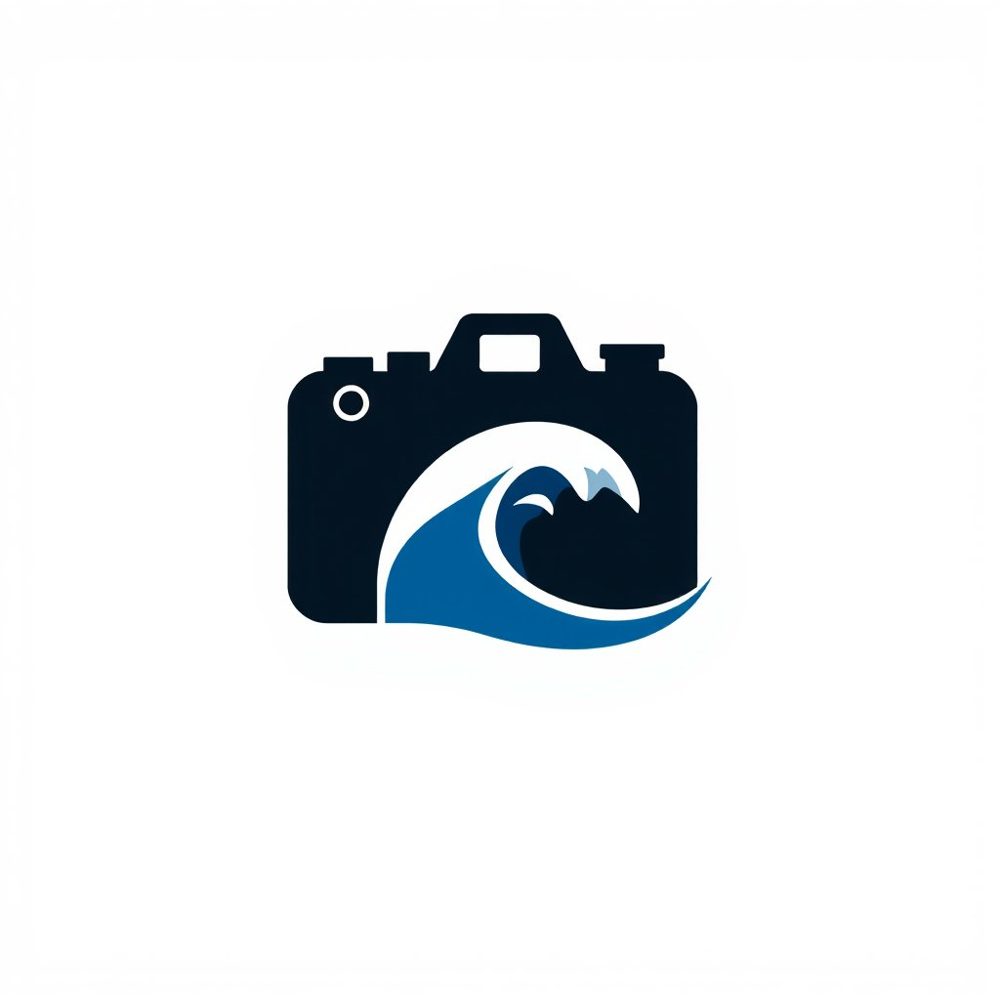

<sub>`fast_preview` · 4 steps · seed 925045642 · 217 s · Output/2026/10/2026-10-28 Southsea Photography Logo</sub>

Prompt the orchestrator wrote:

> minimal vector logo of a camera and a stylized ocean wave, single bold symbol, geometric shapes, two or three flat colours, strong silhouette, centred, generous margin, on a plain white background

### `icon`

**Single-glyph button or app icon, legible at small sizes.** Chosen when: icon, button, Stream Deck key, app icon, symbol, glyph, toolbar.

| Setting | Value |
|---|---|
| Workflow | `clipart` (1024x1024), fixed |
| Model | `fast_preview` |
| FLUX guidance | 3.5 |
| Background | black, unless you name one |
| Always avoided | photograph, text, multiple objects, fine detail, shading, border |

**Prompt pattern** (X is your subject):

> flat icon of X, single centred glyph, thick rounded strokes, one or two high-contrast colours, no detail that disappears at small size

**Example**

```zsh
python controller.py "a Stream Deck icon for starting ComfyUI"
```


<sub>`fast_preview` · 4 steps · seed 4103005501 · 8 s · Output/2026/10/2026-10-28 ComfyUI Stream Deck Icon</sub>

Prompt the orchestrator wrote:

> flat icon of a stylized node-based interface with interconnected nodes and wires, single centred glyph, thick rounded strokes, one or two high-contrast colours, no detail that disappears at small size, on a black background

### `pixel_art`

**Retro 8-bit or 16-bit pixel art.** Chosen when: pixel art, 8-bit, 16-bit, retro game, sprite.

| Setting | Value |
|---|---|
| Workflow | `square` (1152x1152), fixed |
| Model | `highest_quality` |
| FLUX guidance | 4.0 |
| Always avoided | photograph, smooth gradients, blur, high detail, painterly |

**Prompt pattern** (X is your subject):

> pixel art of X, 16-bit retro game style, crisp square pixels, limited palette, no anti-aliasing

**Example**

```zsh
python controller.py "a pixel art sprite of a Portsmouth ferry"
```

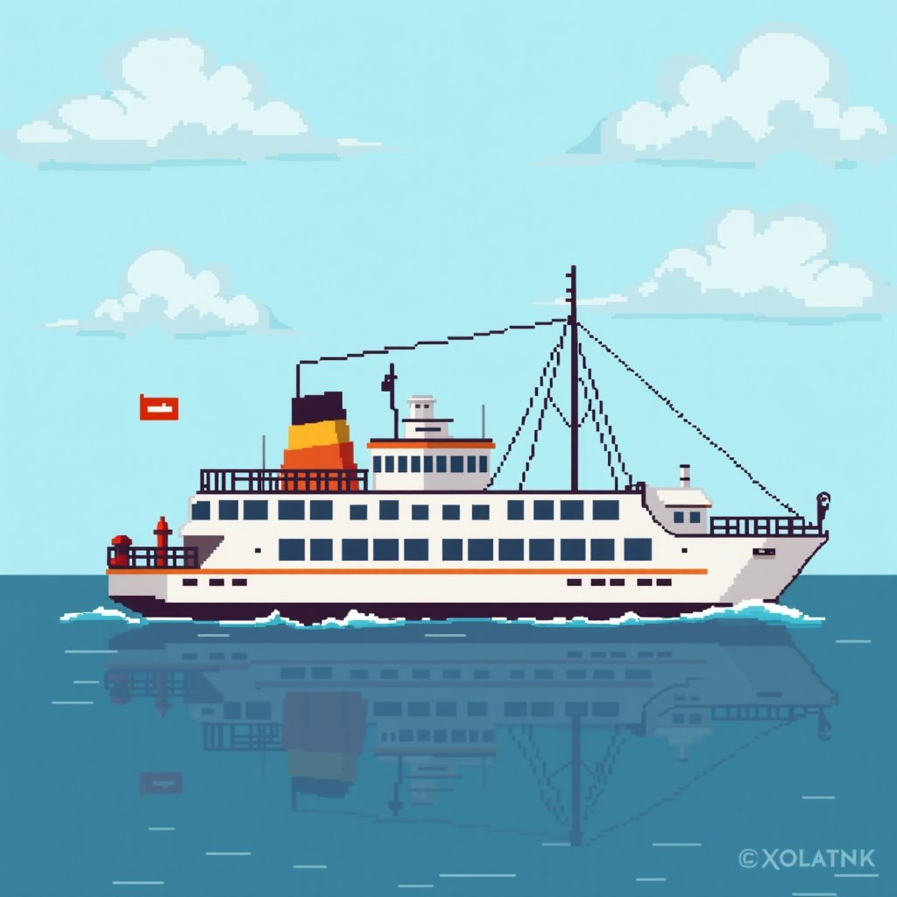

<sub>`highest_quality` · 30 steps · seed 2399470187 · 211 s · Output/2026/10/2026-10-28 Portsmouth Ferry Pixel Sprite</sub>

Prompt the orchestrator wrote:

> pixel art of a Portsmouth ferry boat, 16-bit retro game style, crisp square pixels, limited palette, no anti-aliasing

### `vintage_poster`

**Retro travel or advertising poster.** Chosen when: poster, travel poster, retro poster, vintage advert, railway poster, art deco.

| Setting | Value |
|---|---|
| Workflow | `portrait` (1024x1536) |
| Model | `highest_quality` |
| FLUX guidance | 3.5 |
| Always avoided | photograph, photorealism, gradients, small text, modern |

**Prompt pattern** (X is your subject):

> vintage 1930s travel poster of X, flat screen-printed colour blocks, bold simplified shapes, art deco styling, limited warm palette, strong perspective

**Example**

```zsh
python controller.py "a railway poster for Southsea seafront"
```

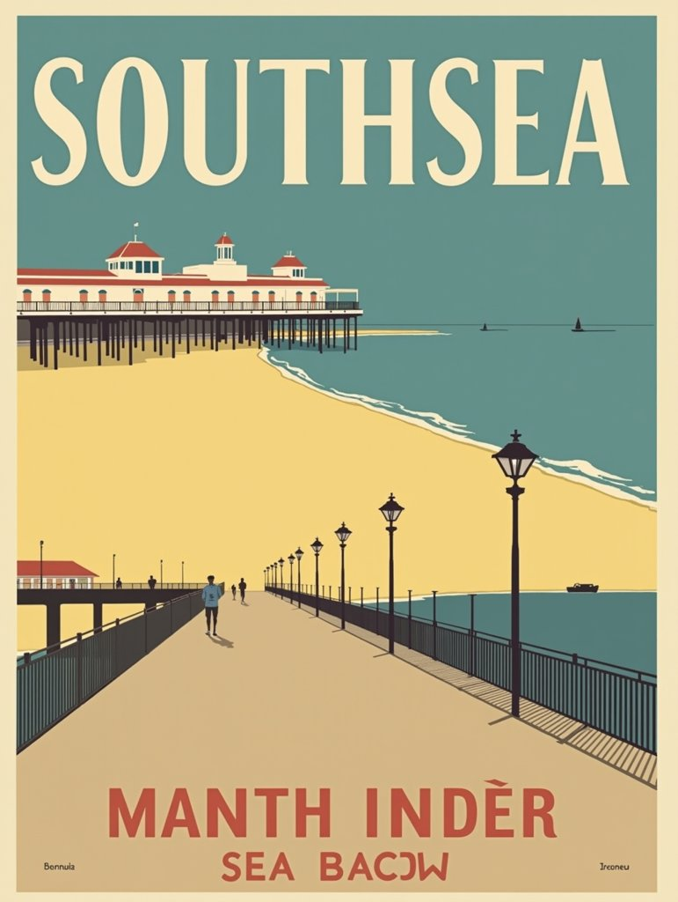

<sub>`highest_quality` · 30 steps · seed 3901197949 · 52 s · Output/2026/10/2026-10-28 Southsea Seafront Railway Poster</sub>

Prompt the orchestrator wrote:

> vintage 1930s travel poster of Southsea seafront with its iconic pier and coastal promenade, flat screen-printed colour blocks, bold simplified shapes, art deco styling, limited warm palette, strong perspective

## Art and illustration types

### `illustration`

**General digital illustration.** Chosen when: illustration, drawing, artwork, concept art, when no specific medium is named.

| Setting | Value |
|---|---|
| Workflow | `landscape` (1536x1024) |
| Model | `highest_quality` |
| FLUX guidance | 3.5 |
| Always avoided | photograph, photorealistic, 3D render, text |

**Prompt pattern** (X is your subject):

> digital illustration of X, clean confident linework, painterly shading, harmonious palette, clear focal point

**Example**

```zsh
python controller.py "an illustration of a fox reading a map in a forest"
```


<sub>`highest_quality` · 30 steps · seed 3719009705 · 26 s · Output/2026/10/2026-10-28 Fox Reading Map In Forest</sub>

Prompt the orchestrator wrote:

> digital illustration of a fox reading an old paper map in a lush forest, clean confident linework, painterly shading, harmonious palette, clear focal point

### `watercolour`

**Loose, translucent watercolour painting.** Chosen when: watercolour, watercolor, wash, aquarelle.

| Setting | Value |
|---|---|
| Workflow | `landscape` (1536x1024) |
| Model | `highest_quality` |
| FLUX guidance | 3.0 |
| Always avoided | photograph, hard digital lines, heavy outlines, 3D |

**Prompt pattern** (X is your subject):

> watercolour painting of X, loose wet-on-wet washes, soft bleeding edges, visible cold-press paper texture, white of the paper left as highlights, limited palette

**Example**

```zsh
python controller.py "a heron at Langstone Harbour"
```

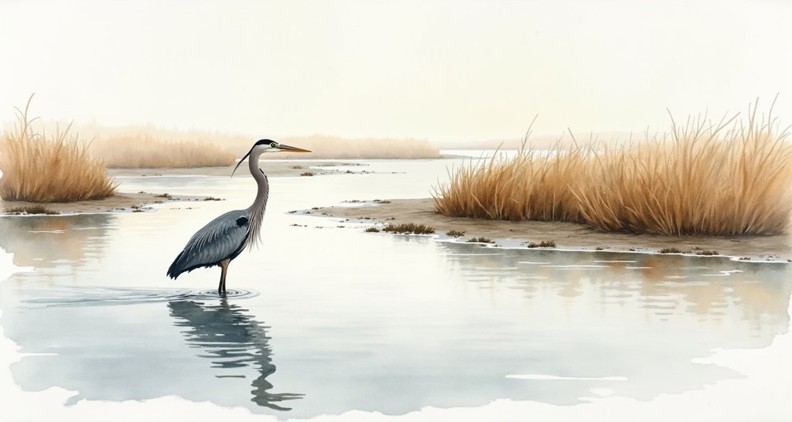

<sub>`highest_quality` · 30 steps · seed 2338893660 · 233 s · Output/2026/10/2026-10-27 Heron at Langstone Harbour</sub>

Prompt the orchestrator wrote:

> watercolour painting of a grey heron standing in the tidal waters of Langstone Harbour, with salt marshes and coastal reeds in the background, loose wet-on-wet washes, soft bleeding edges, visible cold-press paper texture, white of the paper left as highlights, limited palette

### `oil_painting`

**Traditional oil painting on canvas.** Chosen when: oil painting, oils, impasto, painted on canvas, old master, impressionist.

| Setting | Value |
|---|---|
| Workflow | `landscape` (1536x1024) |
| Model | `highest_quality` |
| FLUX guidance | 3.0 |
| Always avoided | photograph, digital art, flat colour, outlines |

**Prompt pattern** (X is your subject):

> oil painting of X, visible impasto brushstrokes, canvas weave, rich layered colour, classical composition, painterly light

**Example**

```zsh
python controller.py "HMS Victory in dry dock as an impressionist oil painting"
```

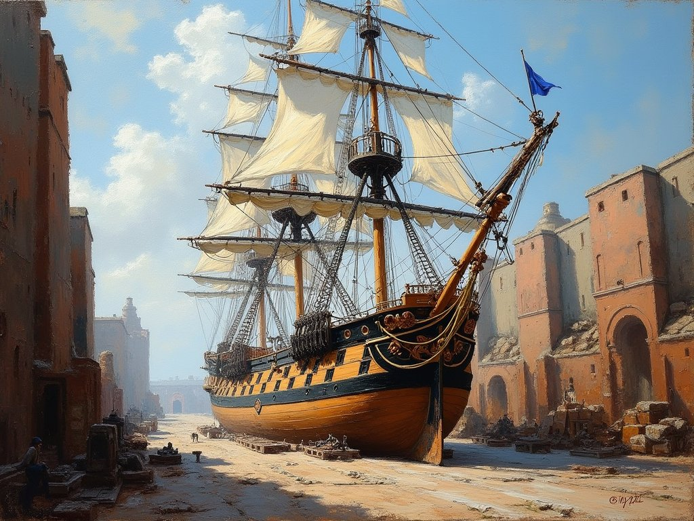

<sub>`highest_quality` · 30 steps · seed 1195589619 · 26 s · Output/2026/10/2026-10-28 HMS Victory Oil Painting</sub>

Prompt the orchestrator wrote:

> oil painting of the HMS Victory warship in a dry dock, rendered in an impressionist style, visible impasto brushstrokes, canvas weave, rich layered colour, classical composition, painterly light

### `pencil_sketch`

**Graphite or charcoal drawing.** Chosen when: pencil, sketch, graphite, charcoal, drawn by hand, study.

| Setting | Value |
|---|---|
| Workflow | `portrait` (1024x1536) |
| Model | `highest_quality` |
| FLUX guidance | 3.5 |
| Always avoided | colour, photograph, digital painting, clean vector lines |

**Prompt pattern** (X is your subject):

> graphite pencil sketch of X, expressive hatching and cross-hatching, varied line weight, smudged shading, off-white sketchbook paper

**Example**

```zsh
python controller.py "a pencil sketch of an old Leica camera"
```

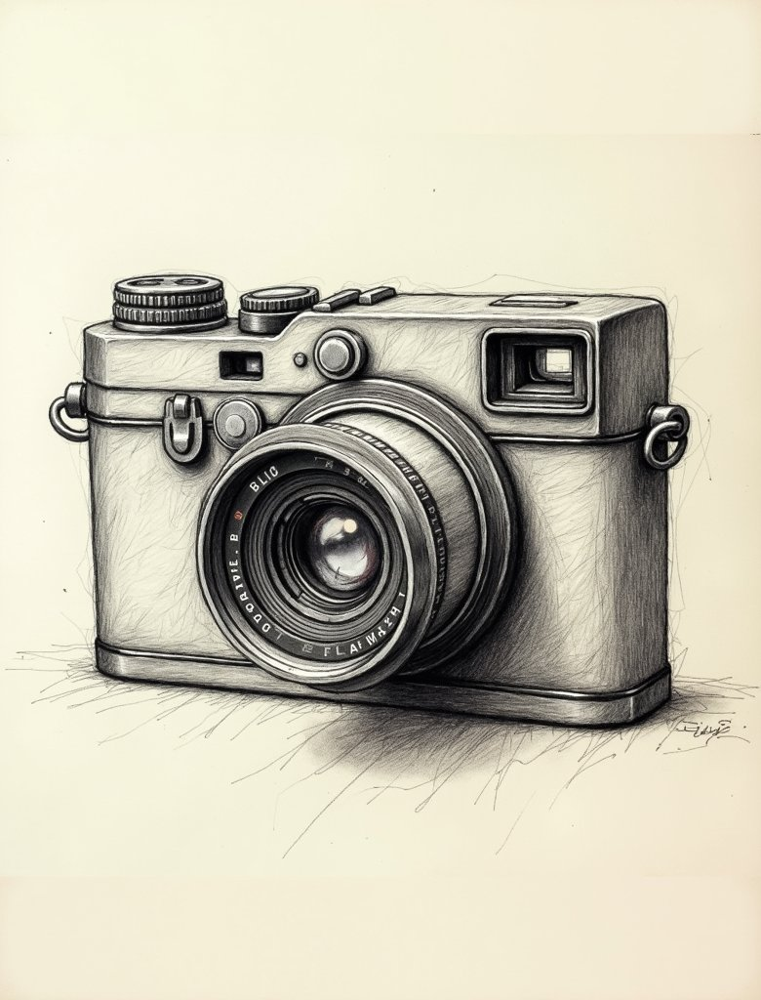

<sub>`highest_quality` · 30 steps · seed 317361572 · 50 s · Output/2026/10/2026-10-28 Vintage Leica Pencil Sketch</sub>

Prompt the orchestrator wrote:

> graphite pencil sketch of an old, vintage Leica camera with intricate mechanical details, expressive hatching and cross-hatching, varied line weight, smudged shading, off-white sketchbook paper

### `line_art`

**Clean black ink outlines, colouring-book style.** Chosen when: line art, line drawing, ink drawing, outline, colouring page, tattoo flash.

| Setting | Value |
|---|---|
| Workflow | `square` (1152x1152), fixed |
| Model | `highest_quality` |
| FLUX guidance | 4.0 |
| Always avoided | colour, shading, grey tones, photograph, texture |

**Prompt pattern** (X is your subject):

> clean black ink line art of X, uniform confident outlines, no shading, no fill, pure white background, colouring-book style

**Example**

```zsh
python controller.py "a colouring page of a seahorse"
```

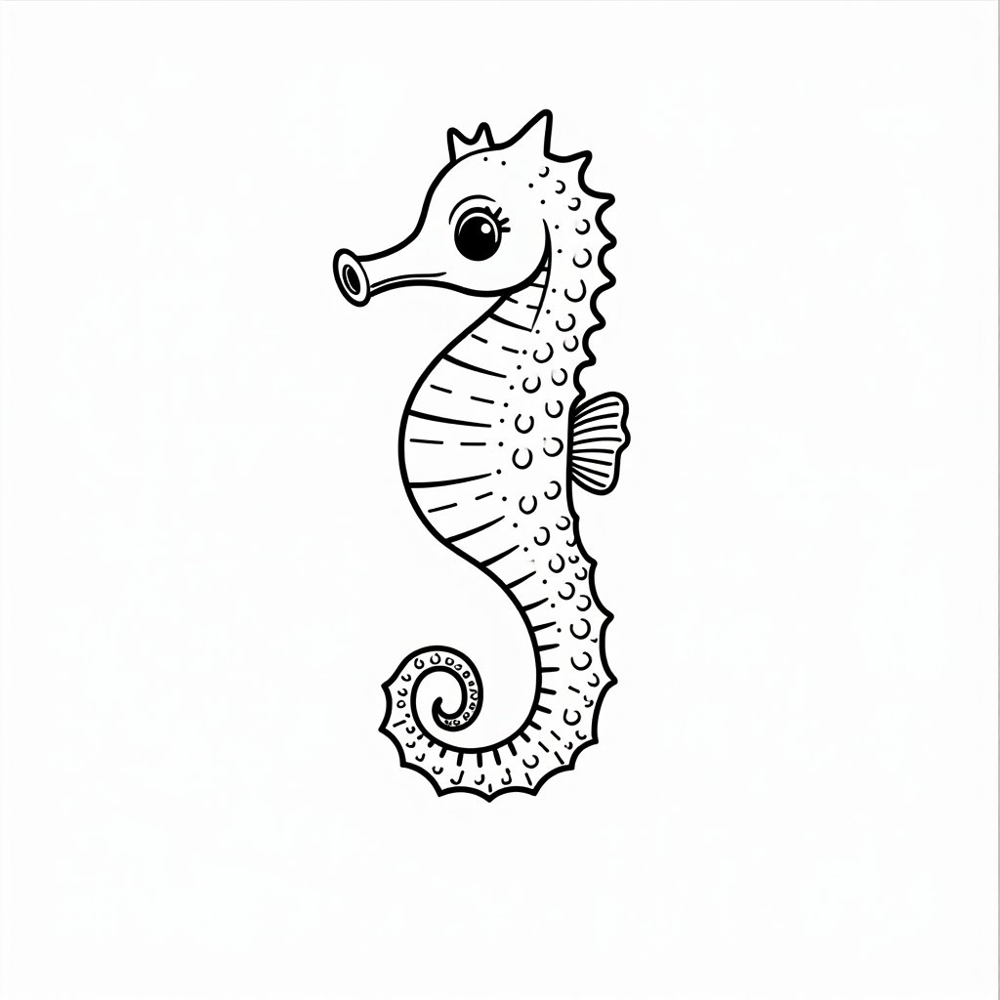

<sub>`highest_quality` · 30 steps · seed 3891905958 · 38 s · Output/2026/10/2026-10-28 Seahorse Colouring Page</sub>

Prompt the orchestrator wrote:

> clean black ink line art of a cute seahorse, uniform confident outlines, no shading, no fill, pure white background, colouring-book style

### `storybook`

**Warm children's picture-book illustration.** Chosen when: children's book, picture book, storybook, bedtime story, whimsical, cute scene.

| Setting | Value |
|---|---|
| Workflow | `landscape` (1536x1024) |
| Model | `highest_quality` |
| FLUX guidance | 3.5 |
| Always avoided | photograph, scary, dark, realistic anatomy, text |

**Prompt pattern** (X is your subject):

> children's picture-book illustration of X, soft gouache textures, warm gentle palette, rounded friendly shapes, whimsical storytelling composition

**Example**

```zsh
python controller.py "a hedgehog sailing a teacup across a pond"
```

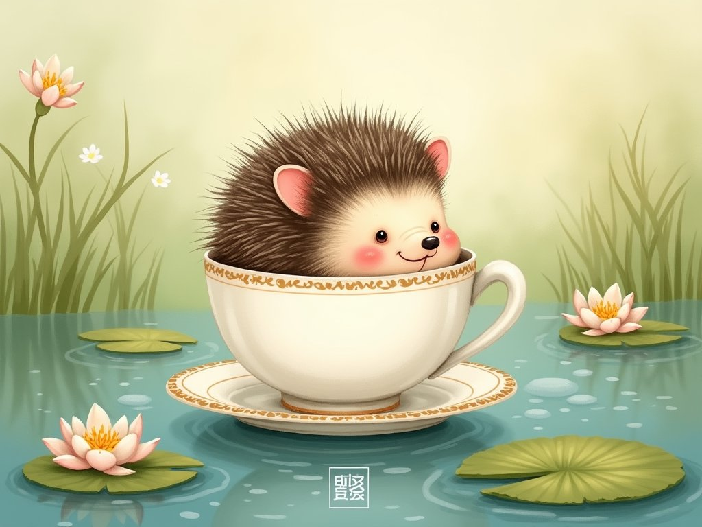

<sub>`highest_quality` · 30 steps · seed 2680893108 · 26 s · Output/2026/10/2026-10-28 Hedgehog Teacup Voyage</sub>

Prompt the orchestrator wrote:

> children's picture-book illustration of a tiny hedgehog sailing inside a delicate porcelain teacup across a calm pond with lily pads, soft gouache textures, warm gentle palette, rounded friendly shapes, whimsical storytelling composition

### `3d_render`

**Polished 3D render or isometric scene.** Chosen when: 3D, render, CGI, isometric, claymation, toy-like, diorama.

| Setting | Value |
|---|---|
| Workflow | `square` (1152x1152) |
| Model | `highest_quality` |
| FLUX guidance | 3.5 |
| Always avoided | photograph, flat 2D, sketch, noisy, text |

**Prompt pattern** (X is your subject):

> 3D render of X, soft studio lighting, smooth matte materials, gentle ambient occlusion, isometric or three-quarter view, clean minimal scene

**Example**

```zsh
python controller.py "an isometric diorama of a tiny photography studio"
```

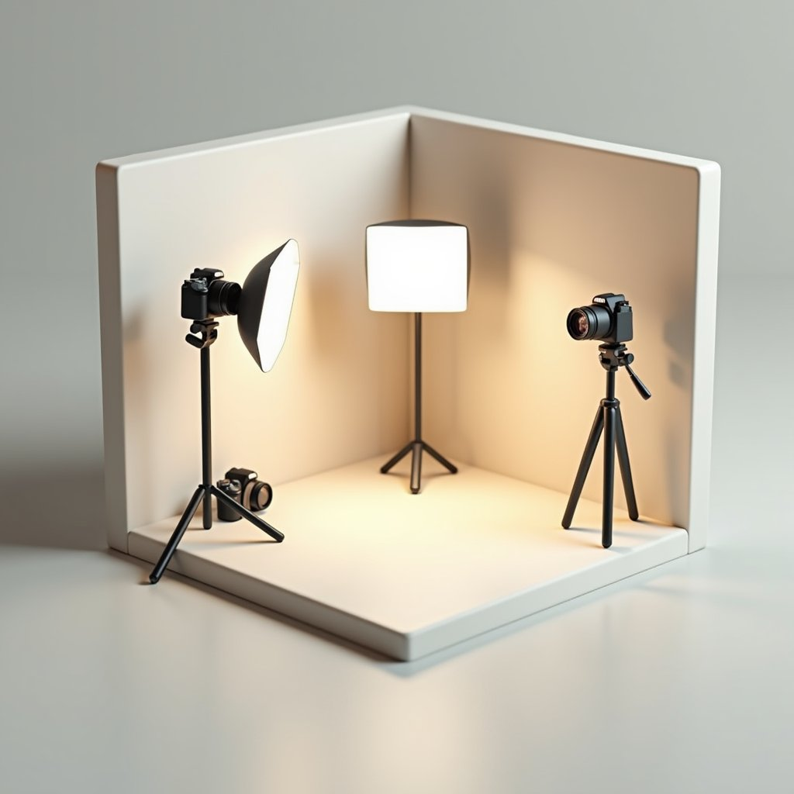

<sub>`highest_quality` · 30 steps · seed 699100232 · 38 s · Output/2026/10/2026-10-28 Tiny Photography Studio Diorama</sub>

Prompt the orchestrator wrote:

> 3D render of a tiny photography studio diorama, featuring miniature cameras, small softboxes, a tiny tripod, and a miniature backdrop stand, soft studio lighting, smooth matte materials, gentle ambient occlusion, isometric or three-quarter view, clean minimal scene

## Adding or changing a type

Add an entry under `styles.types` in `config.yaml`. Every field below is required unless marked optional; the config loader stops with a clear error if one is missing or invalid.

| Field | Meaning |
|---|---|
| `family` | `photo`, `graphic` or `art`; sets the vocabulary rules |
| `description` | One line saying what the type produces |
| `choose_when` | Trigger words and situations the LLM matches against |
| `prompt` | The positive-prompt pattern, with X standing for the subject |
| `avoid` | Always placed at the start of the negative prompt |
| `workflow` | Default shape, a key of `workflows.map` |
| `lock_workflow` | Optional. `true` stops the LLM or `--workflow` moving it to another shape |
| `model` | Default model capability, a key of `models.map` |
| `cfg` | FLUX guidance used for every run of this type |
| `background` | Optional. The prompt must end "on a <colour> background" |
| `example` | A typical request, shown by `--list-styles` and used to find or make the example image |
| `example_image` | Optional. Pin this document's example to a run folder, relative to `Output/`, e.g. `2026/10/2026-10-28 Southsea Seafront Railway Poster` |

Test a new type with a dry run, which shows the orchestrator's spec without generating:

```zsh
python controller.py "your test request" --style newtype --dry-run
```

## Keeping this document current

```zsh
python tools/gen_image_types_doc.py                     # rebuild
python tools/gen_image_types_doc.py --generate-missing  # make missing examples first
```

Without a pin, each type shows the latest run of its `example` request, or else the latest run that used the type. To show a particular image, set `example_image`. Example images are copied to `docs/images/` at up to 1024 px, so commit that folder along with the document.
